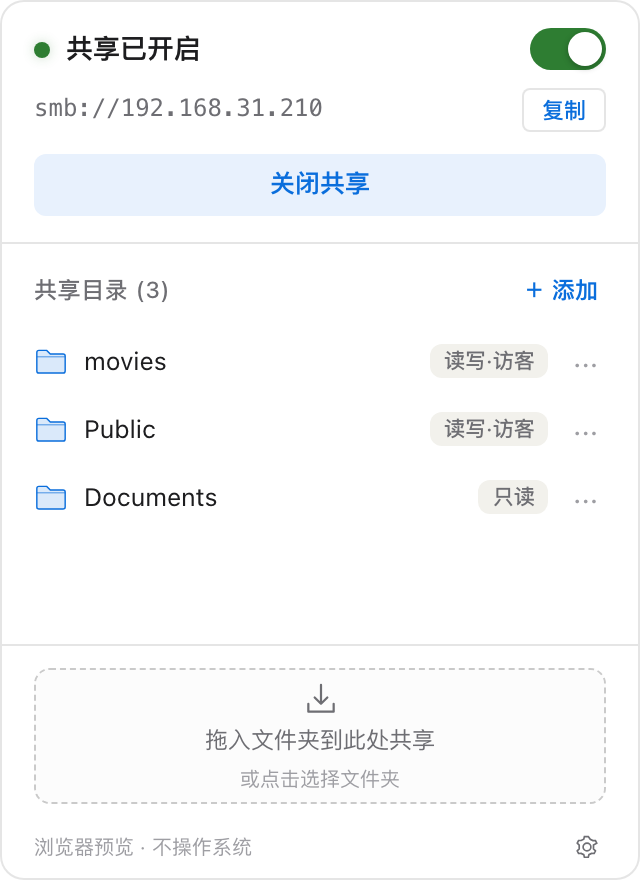
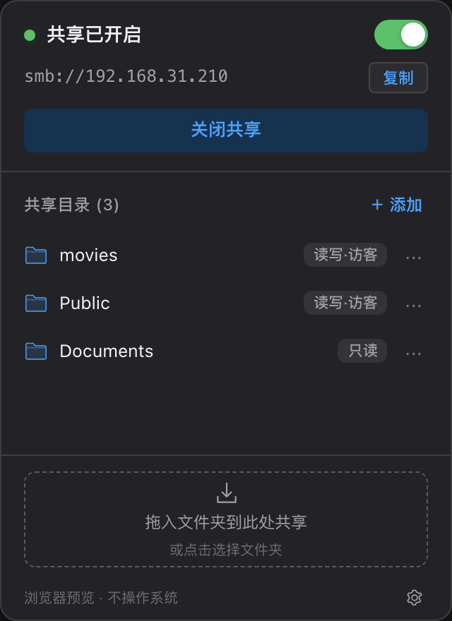
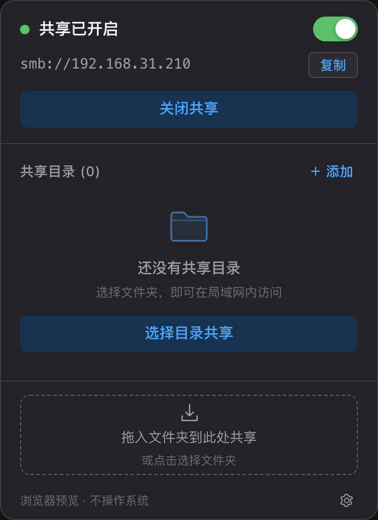

<div align="center">

# drag-share · SMB 共享助手

**把 Mac 上的文件夹共享到局域网，从菜单栏开始。**

**Share folders from your Mac to your local network, right from the menu bar.**

[](https://github.com/longl1005/drag-share/releases)
[](#下载安装)
[](https://v2.tauri.app/)
[](https://vuejs.org/)
[](https://github.com/longl1005/drag-share/actions/workflows/check.yml)

[下载安装](#下载安装) · [快速上手](#快速上手) · [常见问题](#常见问题) · [English](#english)

</div>

<table>
  <tr>
    <td width="33%" align="center"><a href="docs/screenshots/panel-light.png"></a><br /><sub><b>浅色面板</b><br />服务开关与共享目录</sub></td>
    <td width="33%" align="center"><a href="docs/screenshots/panel-dark.png"></a><br /><sub><b>深色面板</b><br />跟随系统明暗主题</sub></td>
    <td width="33%" align="center"><a href="docs/screenshots/panel-empty.png"></a><br /><sub><b>开始共享</b><br />选择或拖入文件夹</sub></td>
  </tr>
</table>

> 截图来自隔离的浏览器预览，目录与地址为演示数据；正式应用读取本机系统配置，不包含预览标记。

## 为什么使用 drag-share？

临时把电影目录交给平板播放器、把设计素材传到另一台电脑，往往需要反复打开系统共享设置。drag-share 将常用操作收进菜单栏：打开面板、共享文件夹、复制地址，用完关闭服务。

应用管理的是 **macOS 内置 SMB 文件共享**，无需部署另一个文件服务器。共享目录配置与服务开关独立：关闭服务保留目录，下次开启继续使用。

## 下载安装

**[前往 Release 下载](https://github.com/longl1005/drag-share/releases/latest)**

| 平台 | 下载 | 状态 |
| --- | --- | --- |
| macOS 13+ · Apple Silicon（M1/M2/M3/M4 等 arm64 芯片） | [DMG 安装包](https://github.com/longl1005/drag-share/releases/download/v0.1.2/drag-share-0.1.2-macos-arm64.dmg) · [应用 ZIP](https://github.com/longl1005/drag-share/releases/download/v0.1.2/drag-share-0.1.2-macos-arm64.app.zip) | v0.1.2 可下载 |
| macOS · Intel | — | 尚未提供构建 |
| Windows / Linux | — | 预留平台接口，尚未实现共享功能 |

1. 下载 DMG 并打开，将 **SMB 共享助手.app** 拖入「应用程序」。也可下载 ZIP，解压后将应用移入「应用程序」。
2. 打开应用，在菜单栏找到共享助手图标。应用默认不显示 Dock 图标或主窗口。
3. 点击图标打开面板，或按 **Control + Option + S**。

当前安装包使用 **ad-hoc 本地签名，未经过 Apple Developer ID 签名与公证**。如果 macOS 提示无法验证开发者，请在确认下载来源后，前往「系统设置 → 隐私与安全性」按系统提示允许打开。无需关闭 Gatekeeper。

Release 同时附带 [SHA256SUMS.txt](https://github.com/longl1005/drag-share/releases/download/v0.1.2/SHA256SUMS.txt)。将校验文件与安装包放在同一目录后，可核对下载文件：

```sh
shasum -a 256 drag-share-0.1.2-macos-arm64.dmg
# 将输出与 SHA256SUMS.txt 中对应文件的值比较。
```

## 功能

### 从菜单栏控制共享

- 菜单栏常驻，显示共享服务状态，左键切换面板、右键打开原生菜单。
- 一键开启或关闭系统 SMB 服务；关闭服务保留已有共享目录。
- 每次打开面板读取最新状态，不在后台定时轮询。
- 当服务开关与实际加载状态冲突时显示「状态待确认」。

### 管理目录与访问地址

- 通过系统文件夹选择器添加目录，或将 Finder 中的文件夹拖入面板底部。
- 展示系统返回的只读、读写与访客属性，标记原路径已不存在的共享。
- 拦截重复目录和普通文件，支持中文、空格与引号等特殊字符。
- 双击目录或打开「··· → 复制目录链接」，复制可直达目录的 `smb://` 地址。
- 顶部一键复制本机地址；无局域网 IP 时回退到 Bonjour 主机名。
- 取消共享前二次确认，只注销共享记录，不删除本地文件。

### 融入 macOS

- **Control + Option + S** 呼出面板；Esc 或点击面板外收起，原生操作期间保护面板。
- 支持登录时静默启动，默认关闭，由用户在右键菜单中启用。
- 一键打开系统共享设置，或在 Finder 中定位目录。
- 右键菜单可勾选「共享时保持唤醒」：默认关闭，记住选择；共享开启期间阻止闲置自动休眠，允许屏幕熄灭。关闭共享、取消勾选或退出工具时自动释放。
- 适配系统浅色、深色主题及原生毛玻璃面板。

## 快速上手

1. **准备系统 SMB 权限**：首次使用时打开「系统设置 → 通用 → 共享 → 文件共享 → 选项」，确认已允许 SMB，并允许需要使用的 macOS 账户访问。
2. **开启共享**：点击菜单栏图标，选择「开启共享」，在 macOS 原生管理员授权框中确认。
3. **添加目录**：点击「＋ 添加」选择文件夹，或将文件夹拖入底部放置区；系统可能再次要求授权。
4. **在其他设备连接**：复制本机或目录地址，在同一局域网内的 SMB 客户端中连接，按需输入系统允许的账户与密码。
5. **用完关闭**：点击「关闭共享」。目录配置保留，之后可以重新开启。

例如，在另一台 Mac 的 Finder 中选择「前往 → 连接服务器」并粘贴地址；在 iPhone/iPad 的「文件」App 中选择「连接服务器」。其他设备可使用支持 SMB 的文件管理器或播放器。

## 共享时保持唤醒

在菜单栏图标上点击右键，勾选 **共享时保持唤醒**。共享服务开启时，应用会阻止 Mac 因闲置自动休眠，便于 iPhone 持续访问或播放共享文件。

- 默认关闭，偏好保存在应用本地配置目录的 `awake.json`；重启应用后记住选择，确认 SMB 已开启后才生效。
- 屏幕仍可正常熄灭；关闭共享、取消勾选或退出应用时释放限制。应用意外退出时，绑定应用进程的系统子进程也会自动结束。
- 不保证合盖、手动选择休眠、低电量关机等情况下继续访问，也不提供公网访问功能。
- 外部系统设置中的 SMB 变更在下次打开面板刷新时同步，不进行后台轮询。

## 本地运行与权限边界

- 应用使用普通用户权限运行，只在修改系统共享配置时请求原生管理员授权。
- 不保存管理员或 SMB 密码，不扫描共享目录内部文件，不提供云同步或遥测。
- 目录访问权限由 macOS 现有配置决定；应用不提供细粒度用户/组权限编辑，也不会替你启用 SMB 账户。
- 本地操作日志位于 `~/Library/Logs/SMBShare/ops.jsonl`，包含操作路径但不包含文件内容或密码；5 MiB 轮转，最多保留 3 份历史文件。
- **退出工具不会自动关闭系统 SMB 服务**。如需停止对外共享，请先点击「关闭共享」。

## 常见问题

**打开后没有窗口？**  
这是菜单栏应用。点击屏幕顶部的共享助手图标，或按 Control + Option + S。

**其他设备连接不上？**  
确认共享已开启、设备位于可互通的局域网、系统 SMB 选项和账户已允许访问。隔离 Wi-Fi、防火墙及客户端的 SMB 配置都可能影响连接。没有启用访客访问时，请使用获授权的 macOS 账户登录。

**为什么增删目录不可用？**  
服务关闭、状态未确认、正在刷新或执行原生操作时，会暂时禁用目录管理。请先开启服务或完成当前操作。

**取消共享会删除文件吗？**  
不会。它只注销系统共享记录；关闭共享服务也不会删除目录配置。

**为什么显示 `.local` 地址？**  
没有获取到活动局域网 IPv4 时，应用使用 Bonjour 主机名。其他设备仍需处于可互通的网络，并支持对应的名称解析。

**可以直接拖到菜单栏图标吗？**  
当前不支持。请先打开面板，再拖入底部虚线区域。

**当前版本验证到了哪些范围？**  
v0.1.2 已通过 50 项本地自动测试、Rust/TypeScript 检查、发布构建与原生只读自检，GitHub macOS CI 也已通过。真实管理员授权、其他设备传输、重启自启及多显示器等 OS 级行为仍需人工验收。详见[验证报告](docs/VERIFICATION.md)。

## 从源码运行

### 前置条件

- macOS 13+；当前发布和本机验证环境为 Apple Silicon。
- Node.js 22、npm、Rust 1.92+。
- Xcode Command Line Tools，以及 [Tauri macOS 开发环境](https://v2.tauri.app/start/prerequisites/)。

```sh
git clone https://github.com/longl1005/drag-share.git
cd drag-share
npm ci
npm run tauri dev
```

桌面开发模式调用真实系统接口，开关及增删操作会触发管理员授权。

| 命令 | 用途 |
| --- | --- |
| `npm run dev` | 浏览器预览，使用隔离演示数据，不操作系统共享 |
| `npm run tauri dev` | 启动完整桌面开发环境 |
| `npm test` | 运行前端单元与组件测试 |
| `npm run build` | TypeScript 检查及前端生产构建 |
| `cargo test --manifest-path src-tauri/Cargo.toml --lib --locked` | 运行 Rust 单元测试，不修改系统 SMB |
| `npx playwright install chromium && npx playwright test` | 验证明暗主题、五种界面状态与交互 |
| `npm run tauri build` | 构建当前平台安装包 |
| `scripts/package-release.sh` | 检查签名和 DMG，整理发布附件及 SHA-256 |

浏览器预览地址：`http://127.0.0.1:1420/?preview=normal&theme=light`。`preview` 可选 `normal`、`off`、`empty`、`loading`、`error`；`theme` 可选 `light`、`dark`。

原生只读自检：

```sh
src-tauri/target/release/drag-share --read-only-check
```

该命令读取真实状态、共享目录和地址，不显示界面、不注册快捷键、不修改共享或登录项。

## 项目结构与贡献

前端位于 `src/`；Rust 后端位于 `src-tauri/src/`，通过 `SmbPlatform` 分离平台逻辑。托盘和窗口由 `desktop.rs` 管理，系统操作经有限 IPC、参数校验和提权通道执行。

欢迎通过 [Issue](https://github.com/longl1005/drag-share/issues) 报告问题或提交聚焦的 Pull Request。请注明应用版本、系统版本、芯片类型及复现步骤；分享日志前移除私人目录和网络信息。

提交前请运行 `npm run check`、Rust 单元测试与 `cargo clippy`，并保持文档和实际行为一致。

[需求文档](docs/PRD.md) · [交互原型](docs/prototype.html) · [验证与人工验收](docs/VERIFICATION.md) · [版本发布](https://github.com/longl1005/drag-share/releases)

---

<a id="english"></a>

# drag-share — English

**A menu-bar companion for macOS built-in SMB file sharing.** Add a folder, copy its network address, and stop the service when you are done. Stopping SMB preserves your configured shares.

## Download and install

Visit [Releases](https://github.com/longl1005/drag-share/releases/latest). Version 0.1.2 provides a **macOS 13+ Apple Silicon (arm64)** DMG and an application ZIP. Intel, Windows and Linux builds are not available in this release.

Open the DMG and drag **SMB 共享助手.app** into Applications, or extract the ZIP and move the app there. Launch it and click its menu-bar icon. The app does not show a Dock icon or a main window on startup. The interface is currently Simplified Chinese.

The app is ad-hoc signed but has **no Developer ID signature or Apple notarization**. After checking the download source, follow macOS instructions in **System Settings → Privacy & Security** if the first launch is blocked. Disabling Gatekeeper is not required. Release assets include `SHA256SUMS.txt` for integrity checks.

## Features

- Start or stop the system SMB service without deleting share configuration.
- Add folders with the native picker or drop them into the panel; reject duplicate folders and ordinary files.
- Display system-reported access flags and warn about missing directories.
- Copy host or URL-encoded folder addresses, including names containing Chinese text, spaces and quotes.
- Toggle the panel with **Control + Option + S**, enable optional login startup, reveal folders in Finder and open sharing settings.
- Follow system appearance; refresh when opened rather than polling in the background.

## Keep the Mac awake while sharing

Right-click the menu-bar icon and enable **共享时保持唤醒** (Keep awake while sharing). It is off by default and remembers your choice. While SMB is enabled, it prevents idle system sleep but allows display sleep. Disabling sharing, unchecking the option or quitting releases the assertion; the helper is also tied to the app process lifetime.

Lid closure, explicit sleep and low-battery shutdown are not overridden. This does not enable Internet access. External SMB changes are reconciled when the panel refreshes, without background polling.

## Getting started

1. In macOS sharing settings, enable SMB and allow the accounts you intend to use. The app does not configure SMB accounts or store their passwords.
2. Open the panel and start sharing. macOS requests administrator authorization for system changes.
3. Add a directory, copy its address and connect from an SMB client on the same reachable local network.
4. Stop sharing when finished. Removing a share unregisters it without deleting local files. **Quitting the app does not stop the system SMB service.**

Permissions follow existing macOS configuration. There is no cloud service, telemetry or directory-content scanning. Local operation logs contain paths, not file contents or credentials. Login startup is off by default.

## Build and contribute

Requires Node.js 22, npm, Rust 1.92+, Xcode Command Line Tools and a macOS Tauri development environment.

```sh
git clone https://github.com/longl1005/drag-share.git
cd drag-share
npm ci
npm run tauri dev
```

Use `npm run check` for frontend tests and build, `cargo test --manifest-path src-tauri/Cargo.toml --lib --locked` for backend tests, and `npm run tauri build` for native bundles. `scripts/package-release.sh` validates and collects distribution assets.

Browser previews use isolated fixtures; the desktop app uses real system state. The release passed 50 local automated tests and macOS CI. Real administrator dialogs, device transfers, login startup, multi-monitor behavior and long-duration resource targets remain manual acceptance items. See the [verification report](docs/VERIFICATION.md) before treating these as validated.

Issues and focused pull requests are welcome. Include your app version, macOS version, chip architecture and reproduction steps, and redact private paths or network information from logs.
