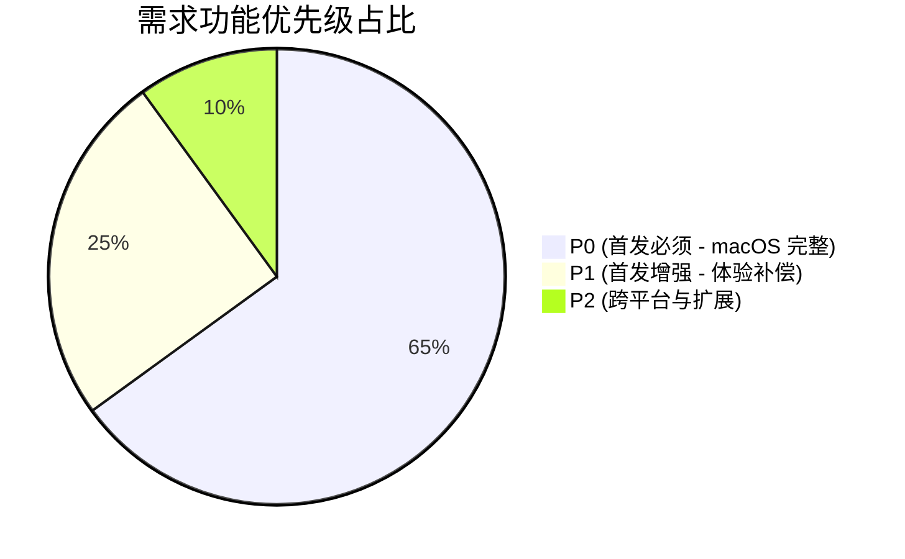
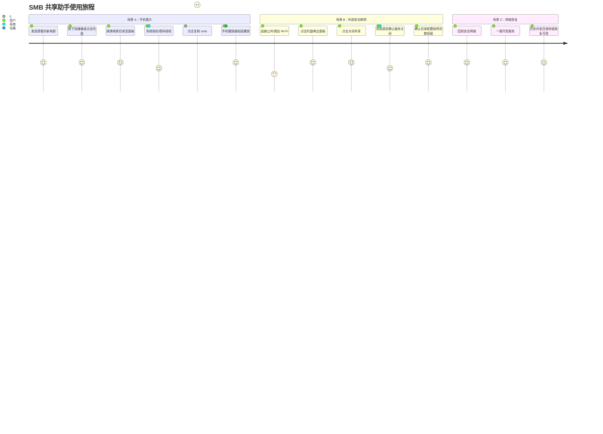
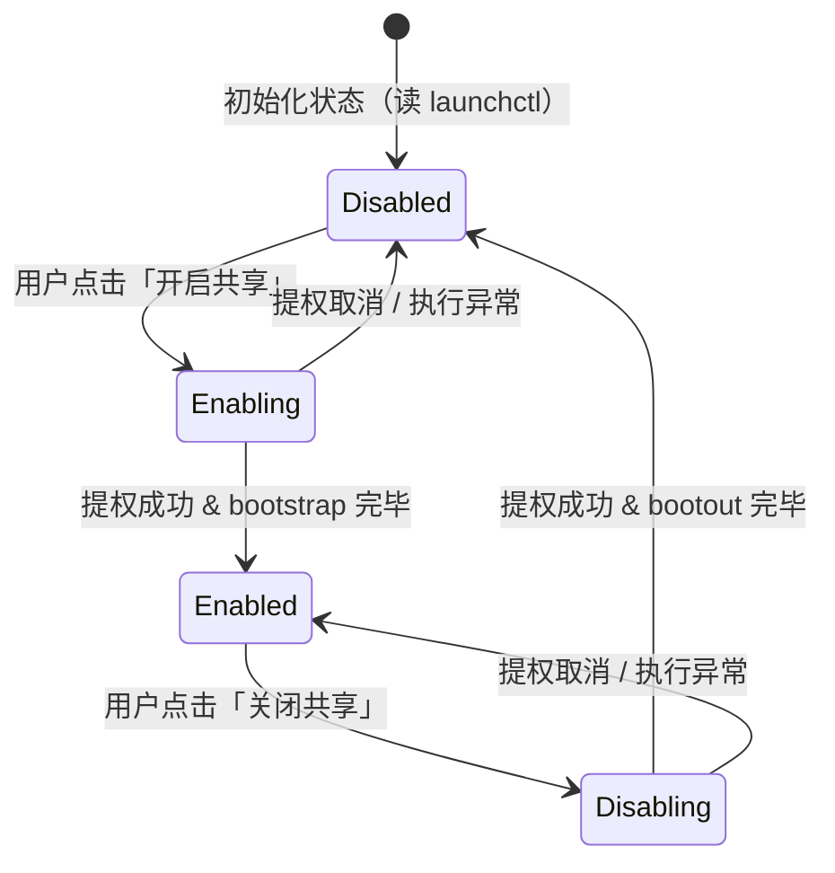
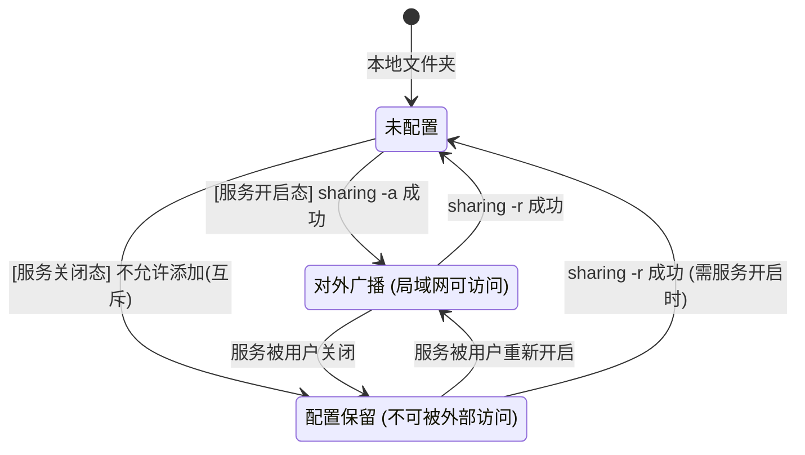
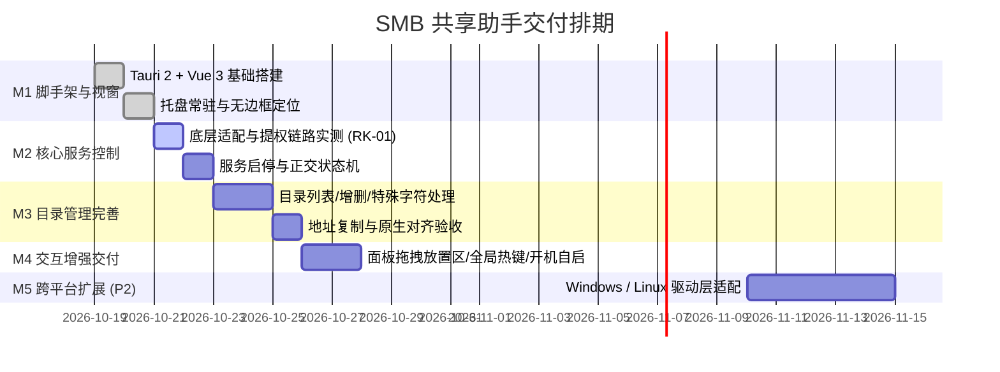

# SMB 共享助手（跨平台版）产品需求文档 (PRD)

| 文档属性 | 详细内容 |
|---|---|
| **产品名称** | SMB 共享助手 (SMB Share Assistant / drag-share) |
| **文档版本** | v2.1 (正式标准版) |
| **文档状态** | 评审通过 / 待开发 (Approved for Development) |
| **技术栈** | Tauri 2.x + Vue 3 + TypeScript + Rust 1.92+ |
| **目标平台** | macOS 13+ (首发完整实现)；Windows 10+ / Linux (架构预留) |
| **前身项目** | Swift / AppKit 原生版（已验证核心底层方案） |

---

## 一、文档信息与版本历史

### 1.1 版本演进记录

| 版本号 | 发布日期 | 负责人 | 变更类型 | 核心变更摘要 | 评审状态 |
|---|---|---|---|---|---|
| v1.0 | 2026-10-18 | 司南 / 龙 | 初始草案 | 完成目标定义、功能初分级、底层命令调研与风险梳理 | 已废弃 |
| v1.0-精简 | 2026-10-18 | 龙 | 决策基线 | 拍板技术方案（确定 Tauri 2）、接受托盘拖拽损失并明确补偿方案 | 已闭环 |
| v2.0 | 2026-10-18 | 司南 | 规范重构 | 按照 15 段完整 PRD 标准重构，补充 GWT 验收标准与异常矩阵 | 评审中 |
| **v2.1** | **2026-10-18** | **司南 / 龙** | **标准终稿** | **统一合并精简版决策与 v2.0 规格，细化系统架构、交互原型与 RTM 追踪，定稿为正式研发标准** | **正式签发** |

### 1.2 RACI 职责矩阵

- **负责人 (Accountable)**：龙（产品设计与技术方向总决策）
- **主要执行人 (Responsible)**：司南（架构设计、前后端开发、单测编写）
- **咨询方 (Consulted)**：macOS / Linux 社区关于 `launchctl` 与 `samba` 的最佳实践
- **知情方 (Informed)**：局域网终端使用者（手机/平板/协同开发伙伴）

---

## 二、背景与商业价值

### 2.1 业务背景与痛点

在多设备协同工作流中，开发者经常需要将 Mac 上的电影、代码工程、设计素材临时共享给手机、平板或其他 PC。macOS 系统内置的文件共享功能存在以下显著痛点：
1. **操作链路冗长**：开启共享需要经历 7 步操作（`系统设置 → 通用 → 共享 → 文件共享(i) → 选项 → 勾选 SMB → 共享文件夹(+)`）。
2. **状态感知黑盒**：没有菜单栏常驻图标，用户无法直观得知 SMB 服务当前是否仍在运行，带来隐私与电量安全隐患。
3. **地址获取低效**：无法一键复制带有当前局域网 IP 与 URL 编码的 `smb://` 地址，手机端输入极易出错。
4. **单平台局限**：既有的 Swift/AppKit 原生版仅能在 macOS 运行，无法将相同的操作体验复刻至 Windows 和 Linux 平台。

### 2.2 核心目标与衡量指标 (OKR)

| 编号 | 核心目标 | 量化指标 | 统计口径与说明 |
|---|---|---|---|
| **G1** | **共享操作极简** | 端到端操作 $\le 3$ 步，耗时 $\le 10$ 秒 | 点击托盘 → 选择目录（或拖入）→ 完成共享（不含系统密码输入耗时） |
| **G2** | **常驻轻量低耗** | 安装包 $\le 20\text{MB}$；常驻内存 $\le 150\text{MB}$ | 内存为面板关闭、仅托盘驻留态；CPU 常态占用 $< 1\%$（无后台轮询） |
| **G3** | **跨平台架构复用** | 前端复用率 $100\%$；平台隔离度 $100\%$ | 前端通过 Tauri IPC 通信，平台差异严格收敛于 Rust `trait SmbPlatform` |
| **G4** | **核心能力完全对齐** | 与 Swift 原生版关键能力 $100\%$ 对齐 | 服务启停、增删共享、地址复制行为完全一致，且共享点配置与服务状态正交 |

### 2.3 非目标（明确范围边界）

- **不做** 用户/组级别的细粒度权限配置（统一继承 macOS 系统目录现有文件权限）。
- **不做** AFP、FTP、WebDAV、NFS 等其他共享协议。
- **不做** 共享流量实时监控与文件访问审计日志。
- **不做** 移动端（iOS/Android）或纯 Web 端。
- **不做** 首发多语言支持（首发简体中文，架构预留 i18n key）。

---

## 三、名词与术语定义

| 术语 | 英文 / 缩写 | 详细定义与规范说明 |
|---|---|---|
| **SMB** | Server Message Block | 局域网主流文件共享协议，URL 访问标准为 `smb://<IP_OR_HOST>/<SHARE_NAME>`。 |
| **共享点** | Share Point | 经由系统登记授权对外暴露的一个目录实体，具有名称、物理路径、读写权限及访客控制属性。 |
| **smbd** | macOS SMB Daemon | macOS 系统的 SMB 后台守护进程，由 `launchd` 按 socket 激活机制进行管理。 |
| **服务运行态** | Service State | SMB 服务进程是否处于启用并接受连接的状态（受 `com.apple.smbd` 的 enabled/disabled 控制）。 |
| **共享点配置态** | Config State | 某目录是否已注册为共享点（由 `sharing -l` 决定）。**与服务运行态相互正交**（服务关闭，配置依然保留）。 |
| **提权通道** | Privilege Escalation | 使用 `osascript "do shell script ... with administrator privileges"` 唤起原生密码弹窗，**不存储任何凭据**。 |
| **状态托盘** | Tray | macOS 菜单栏 / Windows 任务栏通知区域常驻图标，指示服务状态并作为主要交互入口。 |
| **浮动面板** | Floating Panel | 点击托盘图标后弹出的 $320 \times 440$ 无边框毛玻璃置顶小窗，作为核心操作界面。 |
| **Bonjour 别名** | Local Hostname | 形如 `MacBook-Pro.local` 的主机名，当局域网 IPv4 获取失败或处于多网卡变动时作为兜底地址。 |
| **TCC** | Transparency, Consent, and Control | macOS 权限管理框架，全局快捷键功能需依赖其「辅助功能」授权。 |

---

## 四、需求范围与优先级划分 (MoSCoW)



### 4.1 详细范围矩阵

| 优先级 | 需求分类 | 覆盖功能项 | 交付标准 |
|---|---|---|---|
| **P0 (Must Have)** | 托盘与面板基础 | 托盘驻留（无 Dock 图标）、双态图标、面板显隐定位、Esc/失焦关闭 | 基础骨架稳定，内存及包体达标 |
| **P0 (Must Have)** | SMB 服务核心 | 服务状态免密查询、一键开启/关闭、提权取消静默降级、关闭态操作互斥 | 严格保证服务与共享配置正交 |
| **P0 (Must Have)** | 目录管理与地址 | 共享点列表渲染、系统目录选择器添加、二次确认移除、中文/空格转义、地址一键复制 | 局域网设备可顺畅连接 |
| **P1 (Should Have)** | 交互体验补偿 | 面板放置区拖拽添加（仅支持目录）、全局快捷键唤出（`Ctrl+Option+S`） | 弥补托盘拖拽缺失，提升盲操效率 |
| **P1 (Should Have)** | 辅助系统集成 | 登录开机自启（`autostart` 插件）、在访达中定位、直达系统共享设置深链 | 深度融入 macOS 生态 |
| **P2 (Could Have)** | 跨平台扩展 | Windows (PowerShell SmbShare) / Linux (Samba) 驱动层实现 | 触发条件：macOS 版稳定使用 2 周 |
| **Won't Have** | 框架限制能力 | 拖拽文件夹直接到菜单栏托盘图标即共享 | Tauri 框架底层不支持，由 P1 拖入区替代 |

---

## 五、方案对比与选型决策

| 评估维度 | 方案 A：Swift / AppKit 原生 | 方案 B：Tauri 2.x + Vue 3 (最终选型) | 方案 C：Electron + Vue 3 |
|---|---|---|---|
| **跨平台潜力** | ❌ 仅限 Apple 生态 | ✅ macOS / Windows / Linux 统一架构 | ✅ 跨桌面三端 |
| **包体体积** | 极小（约 $2\text{MB}$） | **小（约 $8 \sim 15\text{MB}$）** | 巨大（$\ge 150\text{MB}$） |
| **常驻内存** | 极低（约 $30\text{MB}$） | **优异（约 $60 \sim 100\text{MB}$）** | 劣势（$\ge 300\text{MB}$） |
| **启动性能** | 瞬间启动（$<100\text{ms}$） | **快速（冷启 $\le 1\text{s}$，热显 $<50\text{ms}$）** | 较慢（$2 \sim 4\text{s}$） |
| **托盘拖拽支持** | ✅ 原生 `NSDraggingDestination` | ❌ 框架无此事件暴露 | ❌ 框架无此事件暴露 |
| **技术栈复用度** | 中（需深入维护 Swift） | **极高（Vue 3 前端经验 + Rust 系统调用）** | 高（Node.js 前端经验） |
| **系统侵入与提权** | 借助 AppleScript 提权 | **Rust 子进程封装 osascript 提权** | Node `child_process` 提权 |

> **决策结论**：**选定方案 B（Tauri 2.x + Vue 3）**。  
> 它是唯一能够兼顾「跨桌面扩展」与「常驻轻量化」的最优解；虽然失去了托盘图标直接拖入的能力，但通过在面板内提供拖拽区（FR-18）配合全局热键（FR-21），能够完全弥补操作效率损失。

---

## 六、用户角色与场景旅程地图

### 6.1 用户画像

- **核心使用者**：多设备极客/工程师（作者本人），使用 macOS 作为主力工作机，拥有 iPhone、iPad、Android 手机或 Windows 台式机。
- **核心诉求**：无需配置复杂 NAS，随时随地 5 秒内将指定目录共享，手机播放器直接看高清视频，或传输备份文件，用完随时关闭。

### 6.2 用户旅程图 (User Journey Map)



---

## 七、系统架构与模块设计

### 7.1 系统整体逻辑架构

```
┌─────────────────────────────────────────────────────────────────┐
│                    前端展现层 (Vue 3 + TypeScript)               │
│   ┌───────────────┐ ┌────────────────┐ ┌────────────────────┐   │
│   │ 状态与地址区   │ │ 共享目录列表   │ │ 放置拖拽区 (FR-18)  │   │
│   │ (StatusBanner)│ │ (ShareList)    │ │ (DropZone)         │   │
│   └───────┬───────┘ └────────┬───────┘ └─────────┬──────────┘   │
│           │                  │                   │              │
│           └──────────────────┼───────────────────┘              │
│                              ▼                                  │
│                     Tauri IPC Bridge (Invoke)                   │
└──────────────────────────────┬──────────────────────────────────┘
                               │
┌──────────────────────────────▼──────────────────────────────────┐
│                   Rust 核心调度层 (Tauri Core)                   │
│   ┌────────────────┐ ┌────────────────┐ ┌───────────────────┐   │
│   │ TrayManager    │ │ WindowManager  │ │ SecurityValidator │   │
│   │ (托盘事件/菜单) │ │ (显隐/自适应定位)│ │ (白名单/防注入转义)│   │
│   └────────────────┘ └────────────────┘ └───────────────────┘   │
│                              │                                  │
│                              ▼                                  │
│                 trait SmbPlatform (平台抽象契约)                 │
├──────────────────────────────┬──────────────────────────────────┤
│   macOS 实现 (SmbMacOs)      │   Windows / Linux 实现 (P2 Stub)  │
│  - launchctl print/enable    │  - PowerShell Get-SmbShare       │
│  - sharing -l/-a/-r          │  - Samba /etc/samba/smb.conf     │
│  - osascript (提权管道)      │  - 明确返回「当前平台暂不支持」    │
└─────────────────────────────────────────────────────────────────┘
```

### 7.2 核心 Rust 抽象 trait 定义

```rust
#[async_trait]
pub trait SmbPlatform: Send + Sync {
    /// 获取当前 SMB 服务运行状态
    async fn get_service_status(&self) -> Result<bool, SmbError>;
    /// 开启 SMB 服务（需提权）
    async fn enable_service(&self) -> Result<(), SmbError>;
    /// 关闭 SMB 服务（需提权，保留目录配置）
    async fn disable_service(&self) -> Result<(), SmbError>;
    /// 列出所有共享点
    async fn list_shares(&self) -> Result<Vec<ShareItem>, SmbError>;
    /// 添加共享目录（需提权）
    async fn add_share(&self, path: &str, name: Option<&str>) -> Result<(), SmbError>;
    /// 移除共享目录（需提权）
    async fn remove_share(&self, path: &str) -> Result<(), SmbError>;
    /// 获取本机局域网 IP
    async fn get_lan_ip(&self) -> Result<String, SmbError>;
}
```

---

## 八、功能详细规格说明 (Functional Requirements)

### 8.1 托盘与常驻模块 (Tray Module)

#### FR-01: 托盘常驻与生命周期
- **模块**：`Tray` | **优先级**：P0
- **描述**：应用启动后常驻系统状态栏托盘，无常驻主窗口，Dock 栏不显示图标（macOS Accessory 模式）。
- **业务规则**：
  1. 必须配置 `NSApplicationActivationPolicyAccessory`。
  2. 点击面板外部或按 `Esc` 仅隐藏面板 Webview，不得退出后台进程。
  3. 只有点击右键菜单的「退出」或通过 `Cmd+Q` 时方可终止进程。
- **GWT 验收标准**：
  - **Given** 应用被启动，**When** 启动完毕，**Then** 菜单栏出现托盘图标，Dock 栏无图标出现。
  - **Given** 面板处于可见状态，**When** 用户点击桌面空白区域，**Then** 面板隐藏，托盘图标保持。

#### FR-02: 状态指示图标
- **模块**：`Tray` | **优先级**：P0
- **描述**：托盘图标需清晰反映 SMB 服务的当前状态。
- **业务规则**：
  1. 服务开启态：显示实心高亮强调色图标（或带绿色状态指示）。
  2. 服务关闭态：显示灰色/轮廓弱化图标。
  3. 状态变更后，图标更新延迟必须 $\le 1$ 秒，禁止出现前端显示已开而托盘仍为灰色的不一致情况。
- **GWT 验收标准**：
  - **Given** 服务已开启，**When** 观察托盘，**Then** 图标为实心高亮样式。
  - **Given** 用户在面板中执行「关闭共享」成功，**When** 操作完成，**Then** 托盘图标在 1 秒内变为置灰样式。

#### FR-03 & FR-04: 托盘左右键交互
- **模块**：`Tray` | **优先级**：P0
- **描述**：左键单击切换面板显隐，右键单击唤出原生上下文菜单。
- **业务规则**：
  1. 左键单击：若面板处于隐藏状态则弹出，若处于可见状态则隐藏。
  2. 右键菜单：包含固定项——「开启/关闭共享」（动态文案）、「添加共享目录...」、「访问系统共享设置...」（P1）、「开机自启」（带勾选态，P1）、「关于 SMB 共享助手」、「退出」。
- **GWT 验收标准**：
  - **Given** 面板已弹出，**When** 用户再次左键点击托盘图标，**Then** 面板收起。
  - **Given** 用户右键点击托盘图标，**When** 菜单弹出，**Then** 显示原生样式菜单且各项点击响应正常。

---

### 8.2 面板定位与显隐模块 (Panel Module)

#### FR-05: 面板基础形态与失焦关闭
- **模块**：`Panel` | **优先级**：P0
- **描述**：面板为无边框置顶窗口，基准尺寸为 $320\text{px} \times 440\text{px}$，适配 macOS 浅色/深色毛玻璃背景。
- **业务规则**：
  1. 窗口必须开启置顶属性（`always_on_top`）。
  2. 监听窗口失去焦点事件（`on_blur`）及键盘按键 `Esc`，触发立即收起隐藏。
- **GWT 验收标准**：
  - **Given** 用户按 `Esc` 键，**When** 事件捕获，**Then** 面板平滑收起隐藏。

#### FR-06: 托盘对齐自适应定位
- **模块**：`Panel` | **优先级**：P0
- **描述**：面板弹出位置动态吸附于托盘图标下方（若菜单栏在屏幕顶部）或上方（若任务栏在屏幕底部），并自动保证贴合屏幕边缘不越界。
- **业务规则**：
  1. 读取托盘物理坐标与尺寸 `(tray_x, tray_y, tray_w, tray_h)`。
  2. 水平方向：面板水平中心点对齐托盘中心点，若超出屏幕左右边缘，则紧贴屏幕可用区域边缘并留出 $8\text{px}$ 安全内边距。
  3. 垂直方向：菜单栏在顶部时，定位于 `tray_y + tray_h + 6px`。
  4. 兜底策略：若因系统 API 无法获取托盘坐标，兜底居中显示于主屏幕右上角。
- **GWT 验收标准**：
  - **Given** 托盘位于最右侧靠近时钟处，**When** 弹出面板，**Then** 面板右侧距屏幕边缘保持安全距离，绝无部分内容被遮挡出屏。

#### FR-07: 打开即刷新机制
- **模块**：`Panel` | **优先级**：P0
- **描述**：用户每次激活显示面板时，必须触发一次全量状态与共享目录数据刷新。
- **业务规则**：
  1. 面板每次从 `Hidden -> Visible` 时触发 `refresh()`。
  2. 刷新过程中，目录列表区显示骨架屏（Skeleton），避免白屏或界面突跳。
  3. 若外部（如系统设置或其他终端命令）修改了共享点，面板打开时必须即刻呈现最新状态。

---

### 8.3 服务控制模块 (Service Module)

#### FR-08 & FR-09: 一键开启与关闭 SMB 服务
- **模块**：`Service` | **优先级**：P0
- **描述**：提供全局主控制开关，一键启停系统的 SMB 文件共享服务。
- **业务规则**：
  1. **提权强制性**：开启与关闭必须走提权通道，由系统原生密码框验证。
  2. **正交保护（极其重要）**：关闭服务时，仅执行 `bootout` 与 `disable`，**严禁清空或修改任何已存在的共享目录配置**。
  3. 开启服务成功后，状态切换为 Enabled，托盘图标变亮，局域网终端可立即发现并连接。
  4. 关闭服务成功后，状态切换为 Disabled，托盘图标置灰，现有连接断开，外部请求被拒绝。
- **GWT 验收标准**：
  - **Given** 系统配置有 3 个共享目录且服务开启，**When** 用户点击「关闭共享」并授权成功，**Then** 服务停止，面板中 3 个目录依然展示（呈置灰态），外部设备无法建立连接。
  - **Given** 服务处于关闭态，**When** 用户点击「开启共享」并授权成功，**Then** 服务启动，原 3 个目录立刻恢复可访问状态。

#### FR-10: 服务关闭态的操作互斥
- **模块**：`Service` | **优先级**：P0
- **描述**：当 SMB 服务处于关闭状态时，禁止任何对共享目录的新增或修改操作。
- **业务规则**：
  1. 服务关闭时，主界面中的「+ 添加」按钮、拖拽放置区置灰并禁用点击。
  2. 目录项悬停操作按钮禁用，防止在服务未启动时产生非预期的系统冲突。

#### FR-11: 提权取消静默降级
- **模块**：`Service` | **优先级**：P0
- **描述**：当用户在系统原生管理员密码授权弹窗中主动点击「取消」时，系统平稳降级。
- **业务规则**：
  1. `osascript` 退出码为 `-128`（User Canceled）。
  2. 系统将其捕获为用户主动放弃意图，**严禁弹出任何报错 Toast 或警告对话框**。
  3. 界面按钮立即解除 Loading 状态，恢复至点击前的可用状态。
- **GWT 验收标准**：
  - **Given** 用户点击「开启共享」唤起密码弹窗，**When** 用户在密码框中点击「取消」，**Then** 面板不报错，无 Toast 弹出，按钮恢复为「开启共享」。

---

### 8.4 共享目录管理模块 (ShareMgmt Module)

#### FR-12: 共享点列表展现与权限徽标
- **模块**：`ShareMgmt` | **优先级**：P0
- **描述**：完整展示当前系统配置的所有共享目录信息。
- **业务规则**：
  1. 项信息包含：目录名称、物理路径（作为 Tooltip）、读写属性徽标（「读写」/「只读」）、访客属性徽标（「允许访客」/「非访客」）。
  2. 数据必须与底层的 `sharing -l` 命令解析结果严格一致。
- **GWT 验收标准**：
  - **Given** 系统中存在一个只读共享目录 `docs`，**When** 面板渲染，**Then** 对应的列表项明确渲染「只读」徽标。

#### FR-13: 访问地址探测与展示
- **模块**：`ShareMgmt` | **优先级**：P0
- **描述**：在面板状态区高亮展示当前局域网内的 SMB 访问主地址。
- **业务规则**：
  1. 探测优先级：依次检查活动网卡 `en0`（通常为 Wi-Fi）、`en1`（通常为有线以太网）。
  2. 若探测到局域网 IPv4 地址（如 `192.168.31.210`），展示 `smb://192.168.31.210`。
  3. 兜底回退：若未连接任何局域网（无 IP），回退展示本地主机名（如 `smb://MacBook-Pro.local`），并附带弱化文字提示。

#### FR-14: 空状态指引
- **模块**：`ShareMgmt` | **优先级**：P0
- **描述**：当系统中没有任何共享点时，呈现友好引导页面。
- **业务规则**：
  1. 严禁展示一片白屏或光秃秃的空列表容器。
  2. 呈现大尺寸文件夹插标、提示文案「还没有共享目录」以及全宽引导按钮「选择目录共享」。

#### FR-15: 选择目录共享（常规添加）
- **模块**：`ShareMgmt` | **优先级**：P0
- **描述**：通过原生文件选择对话框添加新的共享目录。
- **业务规则**：
  1. 点击「+ 添加」或空态按钮，唤起原生文件夹选择器（仅限选目录，不可选文件）。
  2. 选定目录后校验：若该目录物理路径已存在于共享列表中，阻止提权调用，直接弹出 Toast 提示「该目录已在共享中」。
  3. 校验通过后，调用提权命令 `sharing -a <PATH>` 执行添加。成功后自动静默刷新列表。

#### FR-16: 取消共享（二次确认保护）
- **模块**：`ShareMgmt` | **优先级**：P0
- **描述**：从系统中注销共享目录。
- **业务规则**：
  1. 必须提供二次确认弹窗（“确定要停止共享目录「xxx」吗？”），防止误触断开其他正在传输的设备。
  2. 确认后调用提权命令 `sharing -r <PATH>`，执行移除并刷新。

#### FR-17: 特殊字符与中文路径转义保护
- **模块**：`ShareMgmt` | **优先级**：P0
- **描述**：全面支持含空格、中文、单双引号及特殊符号的目录路径。
- **业务规则**：
  1. 路径拼装到 Shell 时必须经过标准转义（如单引号包裹，单引号内部用 `'\''` 处理），杜绝命令注入风险。
  2. 复制地址时，共享名部分必须经过 `encodeURIComponent` 标准 URL 编码。
- **GWT 验收标准**：
  - **Given** 共享目录为 `/Users/test/我的 电影&视频's`，**When** 添加并复制地址，**Then** 生成的标准 URL 为合法格式，手机播放器可直接识别。

#### FR-18: 面板放置区拖拽添加 (P1 体验补偿)
- **模块**：`ShareMgmt` | **优先级**：P1
- **描述**：支持将 Finder/访达中的文件夹直接拖入主面板底部的虚线区域快速添加。
- **业务规则**：
  1. 拖入响应：当拖拽进入区域时，放置区边框高亮并放大反馈。
  2. 格式校验：若拖入的是普通文件而非目录，释放后立即拒绝并提示「仅支持添加文件夹目录」。
  3. 重复校验与添加流程完全复用 FR-15 的业务规则。

---

### 8.5 剪贴板与地址复制模块 (Clipboard Module)

#### FR-19 & FR-20: 快捷复制单目录与本机地址
- **模块**：`Clipboard` | **优先级**：P0
- **描述**：一键复制可用地址到系统剪贴板。
- **业务规则**：
  1. **单目录复制**：双击列表项或点击项右侧菜单中的「复制地址」，写入 `smb://<IP>/<URL_ENCODED_NAME>`。
  2. **本机地址复制**：点击顶部状态区的「复制」按钮，写入 `smb://<IP>`。
  3. 写入成功后触发轻量 Toast 反馈「已复制到剪贴板」。

---

### 8.6 增强与生态集成模块 (Enhance Module - P1)

#### FR-21: 全局快捷键呼出
- **模块**：`Enhance` | **优先级**：P1
- **描述**：支持通过全局快捷键（默认 `Ctrl+Option+S`）快速切换面板的弹出与隐藏。
- **业务规则**：
  1. 基于 `tauri-plugin-global-shortcut` 注册。
  2. 若快捷键注册因冲突失败，界面给予温和提示，且不阻断主要功能使用。

#### FR-22: 登录开机自启动
- **模块**：`Enhance` | **优先级**：P1
- **描述**：支持跟随系统登录自动静默启动。
- **业务规则**：
  1. 基于 `tauri-plugin-autostart` 官方插件注册为 Login Item。
  2. 开机启动后仅常驻托盘，**禁止自动弹出操作面板**打扰用户。

#### FR-23 & FR-24: 系统设置深链与访达定位
- **模块**：`Enhance` | **优先级**：P1
- **描述**：
  - FR-23：支持从菜单一键打开 macOS「系统设置 → 通用 → 共享」。
  - FR-24：列表项支持点击「在访达中显示」，直接调起 Finder 并定位高亮该文件夹。

---

### 8.7 跨平台适配层 (Platform Trait - P2)

#### FR-25: 平台解耦抽象与 Stub
- **模块**：`Platform` | **优先级**：P2
- **描述**：底层定义标准的 `SmbPlatform` trait。本期针对 Windows 与 Linux 编译目标提供 Stub 实现。
- **业务规则**：
  1. 在非 macOS 平台下调用业务方法时，统一返回明确的本地化错误提示 `Err(SmbError::PlatformNotSupported("当前平台正在适配中，敬请期待 P2 版本"))`。
  2. 禁止出现未实现 Panic 或静默无响应。

---

## 九、业务流程与状态机模型

### 9.1 SMB 服务全局状态机



### 9.2 共享点生命周期与服务正交关系



> **架构定律**：服务状态的迁移**永远不会修改**共享点配置；共享点是持久化的系统设定，服务仅仅是通信阀门。

### 9.3 提权命令执行流程

```mermaid
flowchart TD
    A[用户触发写操作: 开关服务 / 增删共享] --> B[前端向 Rust 发送 IPC Invoke]
    B --> C[Rust 层做白名单与单引号转义]
    C --> D[组装 osascript 提权执行器]
    D --> E{系统密码弹窗}
    
    E -- 用户点击取消 (退出码 -128) --> F[静默处理: 返回 Ok/Canceled, 状态无损回退]
    E -- 输密验证通过 --> G[执行系统底层命令 (launchctl / sharing)]
    
    G --> H{命令退出状态}
    H -- 退出码 0 --> I[操作成功: 写入本地日志, 触发数据即刻刷新]
    H -- 非0 / 超时(>30s) --> J[错误分类处理: 弹出友好 Toast 引导]
```

---

## 十、非功能性需求 (NFR)

### 10.1 性能与资源指标

| 指标维度 | 严格合格线 | 理想冲刺目标 | 验收口径与测试方式 |
|---|---|---|---|
| **安装包体积** | $\le 20\text{MB}$ | $8 \sim 12\text{MB}$ | macOS DMG / App 包大小（含 Rust 二进制与静态资源） |
| **常驻内存占用** | $\le 150\text{MB}$ | $\le 60\text{MB}$ | 面板隐藏、托盘常驻 1 小时后通过 Activity Monitor 观测 RSS |
| **冷启动时长** | $\le 1.0\text{s}$ | $\le 0.5\text{s}$ | 双击 App 到托盘图标稳定出现 |
| **热呼出响应** | $\le 100\text{ms}$ | $\le 40\text{ms}$ | 点击托盘到面板视效展现完成（Webview 预载常驻） |
| **CPU 常态占用** | $< 1\%$ | 接近 $0\%$ | 严禁后台使用 `setInterval` 轮询系统命令，纯事件驱动 |

### 10.2 系统兼容性

- **首发环境**：macOS 13.0 (Ventura) 及以上版本（涵盖 macOS 14 Sonoma、macOS 15 Sequoia 及更新版本）。
- **硬件架构**：原生支持 Apple Silicon (arm64) 与 Intel (x86_64)，首发以 Apple Silicon Native 优先交付。
- **系统工具依赖**：系统自带 `/bin/launchctl`、`/usr/sbin/sharing`、`/usr/sbin/ipconfig`、`/usr/bin/osascript`。

---

## 十一、数据与本地操作日志规范

应用作为本地安全工具，**不设云端数据库、不发任何遥测请求**。所有操作仅在本地保存结构化操作审计日志。

### 11.1 日志文件路径与格式

- **路径**：`~/Library/Logs/SMBShare/ops.jsonl`
- **轮转策略**：单文件最大 $5\text{MB}$，超过自动轮转，最多保留 3 份历史日志。
- **Schema 定义**：

```json
{
  "ts": "2026-10-18T15:30:00.123+08:00",
  "action": "enable_service | disable_service | add_share | remove_share | copy_address",
  "target": "/Users/lilong/Movies",
  "result": "success | error | canceled",
  "error_code": "USER_CANCELED | TIMEOUT | PERMISSION_DENIED | COMMAND_FAILED | null",
  "duration_ms": 120
}
```

### 11.2 隐私保护边界

1. **绝对禁止** 记录用户管理员密码或明文凭证。
2. **绝对禁止** 扫描或记录共享目录内部包含的具体文件名或文件内容。
3. **绝对禁止** 上报设备硬件指纹或网络配置至外部网络。

---

## 十二、权限与系统安全要求

1. **命令执行白名单约束**：
   Rust 后端严禁执行任意 Shell 字符串，仅允许通过硬编码的参数结构体调用 `launchctl`、`sharing`、`ipconfig` 与 `osascript`。
2. **防 Shell 注入机制**：
   所有用户输入的路径参数必须通过严格的单引号封装逃逸：
   ```rust
   fn escape_for_sh(input: &str) -> String {
       format!("'{}'", input.replace("'", "'\\''"))
   }
   ```
3. **最小权限原则**：
   应用自身以普通用户权限启动并运行，绝对不允许以 `sudo` 启动主进程；仅在写入底层共享配置的一瞬间通过 AppleScript 触发提权。

---

## 十三、异常场景与容错矩阵 (Exception Matrix)

| 异常编号 | 触发场景 | 系统外观表现 | 核心容错与应对逻辑 |
|---|---|---|---|
| **E01** | 系统没有任何共享目录 | 列表展示为空 | 触发展示 FR-14 空状态插画与引导按钮 |
| **E02** | 提权时用户点击「取消」 | 密码弹窗消失 | 退出码 `-128`，静默降级（FR-11），状态无缝回退，无弹窗打扰 |
| **E03** | 提权命令执行超时（$>30\text{s}$） | 面板提示加载超时 | 强行终止子进程，界面弹出 Toast 提示「操作超时，请重试」 |
| **E04** | 目录物理路径已不存在 | 外部误删了共享文件夹 | 列表展示该项并打上警告标，支持一键移除失效项 |
| **E05** | 用户重复添加同一目录 | 选择器选了已有目录 | 在提权前拦截，弹出 Toast 提示「该目录已在共享列表中」 |
| **E06** | 路径含空格、中文或特殊符号 | 如 `我的 视频&Photo's` | 转义单引号与特殊字符后执行，复制链接采用 URL 编码 |
| **E07** | 局域网未连接（无 IP） | 无 Wi-Fi 与有线网 | 状态区自动回退展示 `smb://MacBook-Pro.local` 并附带说明 |
| **E08** | 托盘坐标获取异常 | 系统 API 偶发返回空 | 默认定位在主屏幕右上角，距离屏幕边缘保持安全距离 |
| **E09** | 启动服务后端口未监听 | 系统 `smbd` 响应延迟 | 自动执行一次 `kickstart -k` 补救，仍失败时提示前往系统设置查看 |
| **E10** | 非 macOS 平台调用核心命令 | Windows/Linux 触发 | 返回标准 `SmbError::PlatformNotSupported`，弹出未适配提示 |
| **E11** | 按钮频繁疯狂点击 | 用户短时间连续点开关 | 引入防抖与互斥锁（Busy 状态），执行期间禁用所有交互按钮 |
| **E12** | 拖入普通文件而非目录 | 拖拽了 `.zip` 或 `.txt` | 放置区释放后立即提示「仅支持添加文件夹目录」，不触发提权 |

---

## 十四、交互原型与 UI/UX 规范

### 14.1 视觉系统规范

- **基准尺寸**：$320\text{px} \times 440\text{px}$（视网膜屏精细渲染，圆角 $12\text{px}$）。
- **色彩与层级**：
  - 强调色（活跃）：`#0A6EDC` (Light) / `#4DA3FF` (Dark)
  - 成功绿（开启）：`#2E7D32` (Light) / `#5CC16A` (Dark)
  - 危险红（警告）：`#C62828` (Light) / `#FF6B6B` (Dark)
  - 文本分级：主文本 `#1D1D1F`、次要信息 `#6E6E73`、弱化占位 `#AEAEB2`。
- **毛玻璃视效**：窗口背景采用 `rgba(255, 255, 255, 0.85)` 与 `backdrop-filter: blur(24px)`，与 macOS 原生质感融合。

### 14.2 三段式结构布局图解

```
┌───────────────────────────────────────────┐
│ ① 状态控制区 (Status Section, H=96px)      │
│   ● 共享已开启                    [开关]   │
│   smb://192.168.31.210             [复制] │
│   ┌─────────────────────────────────────┐ │
│   │               关闭共享               │ │
│   └─────────────────────────────────────┘ │
├───────────────────────────────────────────┤
│ ② 共享目录列表区 (Share List, 弹性自适应)   │
│   共享目录 (3)                     + 添加 │
│   📁 movies             [读写·访客]   ··· │
│   📁 Public             [读写·访客]   ··· │
│   📁 documents          [只读]        ··· │
├───────────────────────────────────────────┤
│ ③ 拖拽放置区 (Drop Zone, H=68px, P1)      │
│   ╭ - - - - - - - - - - - - - - - - - - ╮ │
│   │         拖入文件夹到此处共享        │ │
│   ╰ - - - - - - - - - - - - - - - - - - ╯ │
└───────────────────────────────────────────┘
```

> **完整交互原型**：已实装于同级工程文件 [`prototype.html`](file:///Users/lilong/workspace/drag-share/prototype.html)，涵盖**正常态、服务关闭态、空态、加载骨架屏态、错误 Toast 态**全量五态的实时切换与交互验证。

---

## 十五、项目里程碑与需求追踪矩阵 (RTM)

### 15.1 研发里程碑规划 (Milestones)



### 15.2 需求追踪矩阵 (Requirements Traceability Matrix)

| 需求编号 | 需求简述 | 优先级 | 对应章节 | 核心验收标准 (Acceptance Criteria) | 交付里程碑 |
|---|---|---|---|---|---|
| **FR-01** | 托盘常驻无 Dock | P0 | §8.1 | 启动仅托盘有图标，Dock 保持干净 | M1 |
| **FR-02** | 状态双态图标 | P0 | §8.1 | 服务开启实心绿，关闭置灰，延迟 $\le 1\text{s}$ | M1 / M2 |
| **FR-03** | 左键切换面板 | P0 | §8.1 | 左键点击顺畅弹出/收起面板 | M1 |
| **FR-04** | 右键系统菜单 | P0 | §8.1 | 右键弹出包含开关/添加/退出的菜单 | M1 / M3 |
| **FR-05** | 面板失焦与 Esc | P0 | §8.2 | 按 Esc 或失焦点击立刻隐藏 | M1 |
| **FR-06** | 托盘对齐定位 | P0 | §8.2 | 自动吸附于托盘垂直轴，不越界屏幕 | M1 |
| **FR-07** | 打开即刷新 | P0 | §8.2 | 每次展开面板时自动重新拉取最新数据 | M2 |
| **FR-08** | 开启 SMB 服务 | P0 | §8.3 | 提权成功后服务启动，图标转实心绿 | M2 |
| **FR-09** | 关闭 SMB 服务 | P0 | §8.3 | 提权成功后服务关闭，目录配置完整保留 | M2 |
| **FR-10** | 关闭态操作互斥 | P0 | §8.3 | 服务关闭时增删目录按钮置灰禁用 | M2 |
| **FR-11** | 提权取消静默 | P0 | §8.3 | 用户取消密码输入，不报错无弹窗 | M2 |
| **FR-12** | 列表与权限徽标 | P0 | §8.4 | 精确展示目录名与只读/访客徽标 | M3 |
| **FR-13** | 局域网地址展示 | P0 | §8.4 | 正确获取 `en0` IP，无网回退 Bonjour | M2 / M3 |
| **FR-14** | 空状态指引 | P0 | §8.4 | 无共享点时呈现插图与全宽添加按钮 | M3 |
| **FR-15** | 选择目录共享 | P0 | §8.4 | 调用原生对话框，重复目录拒绝添加 | M3 |
| **FR-16** | 二次确认移除 | P0 | §8.4 | 弹窗确认后提权移除指定目录 | M3 |
| **FR-17** | 特殊字符转义 | P0 | §8.4 | 中文、空格、单引号路径正常共享且链接转码 | M3 |
| **FR-18** | 面板拖拽共享 | P1 | §8.4 | 文件夹拖入虚线区即共享，普通文件拒绝 | M4 |
| **FR-19** | 复制单目录链接 | P0 | §8.5 | 复制后局域网设备可直达该目录 | M3 |
| **FR-20** | 复制本机链接 | P0 | §8.5 | 复制后局域网设备可浏览根列表 | M3 |
| **FR-21** | 全局快捷键呼出 | P1 | §8.6 | `Ctrl+Option+S` 随时呼出/隐藏面板 | M4 |
| **FR-22** | 开机静默自启 | P1 | §8.6 | 随系统开机自启，仅驻留托盘不弹窗 | M4 |
| **FR-23** | 共享设置深链 | P1 | §8.6 | 点击直达 macOS 系统共享设置面板 | M4 |
| **FR-24** | 访达高亮定位 | P1 | §8.6 | 点击在 Finder 中定位并高亮目录 | M4 |
| **FR-25** | 跨平台契约预留 | P2 | §8.7 | 非 macOS 平台调用返回明确 Stub 提示 | M5 |

---

## 十六、附录：macOS 底层命令速查手册

```bash
# 1. 查询 SMB 服务启用状态（免密执行）
launchctl print-disabled system | grep com.apple.smbd

# 2. 开启 SMB 服务（需通过 osascript 提权执行）
launchctl enable system/com.apple.smbd
launchctl bootstrap system /System/Library/LaunchDaemons/com.apple.smbd.plist
launchctl kickstart -k system/com.apple.smbd

# 3. 关闭 SMB 服务（需通过 osascript 提权执行）
launchctl bootout system/com.apple.smbd
launchctl disable system/com.apple.smbd

# 4. 列出所有共享目录配置（免密执行）
# 注意：输出字段为制表符（Tab）分隔，解析前必须进行连续空白折叠容错
sharing -l

# 5. 添加共享目录（需提权执行，默认继承访客与读写属性）
sharing -a '/path/to/folder'

# 6. 移除共享目录（需提权执行，仅注销配置，不删除物理文件）
sharing -r '/path/to/folder'

# 7. 探测局域网活动 IPv4 地址（免密执行）
ipconfig getifaddr en0 || ipconfig getifaddr en1

# 8. AppleScript 提权管道标准封装范式
osascript -e 'do shell script "launchctl enable system/com.apple.smbd && launchctl bootstrap system /System/Library/LaunchDaemons/com.apple.smbd.plist" with administrator privileges'
```

---

> **合规与版权声明**：本需求文档为 SMB 共享助手（跨平台版）唯一权威开发标准。所有系统调用遵循 Apple macOS 开发者规范与最小权限原则，不设任何未经披露的外部网络请求。
